# FluxMQ

FluxMQ is a single-binary message broker written in Rust with observability built in. It
offers three delivery modes (replayable streams, competing-consumer queues and per-key
ordered channels) with at-least-once delivery, retries with backoff, and a dead-letter
queue. It ships with a web console that shows live aggregates (health, traffic, lag,
errors), not a raw firehose: the broker computes rates, percentiles and alerts itself,
and the UI follows them over one WebSocket. You don't need a separate Prometheus,
Grafana or admin tool to see what is wrong and act on it.

> Status: **v0.11.0** — single node or a replicated, self-balancing cluster with node
> decommissioning, batched delivery, TLS on every port (client mTLS with certificate-to-role
> bindings, HTTPS, node-to-node mTLS), access tokens/roles with live-session revocation,
> content-based routing, notifications, HTTP push webhooks, backups, a Docker image and a
> comparative benchmark against Kafka and RabbitMQ. Usable for development and evaluation; see
> [Status and roadmap](#status-and-roadmap) for what is not done yet.

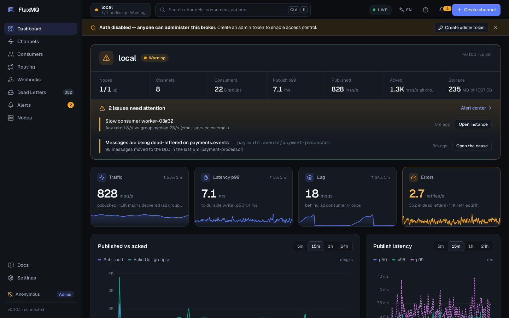

## New in v0.11

- **Webhooks: circuit breaker.** With `pause_after_failures: N` (the console offers 5 for new webhooks; 0 = off),
  N failed requests in a row pause delivery instead of burning retries: messages wait in the channel and do not go
  to the DLQ while the receiver is down. A probe request goes out every 2 → 60 s, and the first answer resumes
  delivery. Live check: a receiver down for minutes, then 1 669 messages delivered after it came back, 0 in the DLQ
  (without the breaker: 2.7K failures).
- **Webhook activity:** the last 100 requests per node (`GET /api/webhooks/{id}/attempts`) and delivery/latency
  history (`/history?range=15m|1h|24h`), merged across the cluster. The console shows an activity chart, recent
  requests, a pause banner and "Rewind position…" on the webhook page.
- **Console:** a "CPU profile" button on the Nodes page (admin, builds with `--features profiling`; `/api/health`
  now lists `features`): flame graph or folded stacks for 10/30/60 s. Phone layout fixes, checked by an automated
  screenshot audit (`scripts/ui-shots.mjs`: 0 findings over 88 shots).

## New in v0.10.1

- **SDK: no lost acks on close.** Three races could drop a consumer's last buffered acks when the client closed or
  unsubscribed (the messages were then redelivered: duplicates, not loss): a flush racing the connection close, the
  socket closing with unread data (RST instead of FIN, so the broker discarded the final frames), and `Unsubscribe`
  overtaking acks still being queued. All fixed; the stress test that exposed them went from ~1.5 % failures to 0 of
  1 600 runs.
- **Catch-up +17 %:** disk reads no longer zero their 4 MiB buffer before `pread` overwrites it (1 node, 1 KiB:
  ~720k → ~840k msg/s on the same host, ~12 % less broker CPU).
- **Built-in CPU profiler** (`--features profiling`, admin-only `GET /api/debug/pprof/profile`), `bench/profile.sh` and
  `scripts/pprof-top.py`; works in containers and WSL where `perf` does not. Findings in
  [bench/results/20261012-v0.11-profile](bench/results/20261012-v0.11-profile/README.md).

## New in v0.10

- **Live subscriptions for browsers and devices:** `GET /api/channels/{name}/live` (WebSocket) and `/events` (SSE),
  read-only (only data ≤ high watermark), resumable by cursor without loss or duplicates, filters, one shared read per
  channel, a `subscriber` role, `--live-*` limits and `fluxmq_live_*` metrics
  ([design](docs/design/v0.10-live-gateway.md)). Load test: 2 000 subscribers, 40 M deliveries, none lost.
- **Kernel TLS** on Linux (`FLUXMQ_TLS_IMPL=ktls`, opt-in): equal saturation and latency, but catch-up 20–27 % slower
  than the userspace record layer on the test host, so the default stays userspace ([design](docs/design/v0.10-ktls.md)).
- **Console:** human-readable DLQ reasons (RU/EN), dangerous actions behind a menu with confirmation, ready-made
  recipes in the docs, health statuses with explanations.

## New in v0.9 (commit path)

- **Per-partition completion:** a partition's publishes are acked as soon as that partition's own fsync finishes, not
  when the slowest partition of the commit does. With one slow partition the others stay at 9 / 14 ms p50 / p99
  instead of 44 / 68 ms.
- **Non-blocking commit pipeline (default on):** the channel writer keeps appending while earlier batches fsync; marks
  are published strictly in order per partition. Same-host A/B against v0.8.0: +11–15 % consumed at 1 KiB 4×4 on 1 and
  3 nodes; the 3-node 50k p99 stays bound by the shared laptop SSD (within noise of v0.8.0).
- **Durability unchanged:** an ack still needs the leader's fsync and every ISR member's. Overlapping fsyncs of one
  file never share a file description, so a writeback error cannot be reported to the wrong commit (a latent hazard
  in the old opt-in pipeline). `FLUXMQ_COMMIT_PIPELINE=off` restores the v0.8 commit path. Design and numbers:
  [docs/design/v0.9-commit-path.md](docs/design/v0.9-commit-path.md).
- **v0.8.0 TLS** (in the report): TLS overhead at 1 KiB 1×1 −63 % → −17 %, 3 nodes −3 %; FluxMQ with TLS is 1.5–2.7×
  Kafka with TLS.

## Benchmarks v0.8 (zero-copy hot path, fetch-ahead, paced retention)

[bench/report/index.html](bench/report/index.html), set `20261010-v0.8`, with key answers in Russian and English and the
v0.8 goals marked met or not met. Setup: 2 CPUs / 2 GiB per broker, fsync before every ack, consumed msg/s.
- **On one node at 1 KiB, as fast as Kafka's default:** 489k / 547k msg/s (1×1 / 4×4) vs Kafka 470k / 538k measured the
  same day. v0.7 managed 231k / 320k. Against Kafka with fsync per message (equal durability): 1.4–1.6× on 1 node, 1.7–2.3× on 3 nodes.
- **3 nodes:** 278k / 273k at 1 KiB (Kafka 253k / 251k) and 1.09M at 100 B 4×4. Catch-up is 2.5–4.6× Kafka, and the consumers
  get 1.16M msg/s under overload. Broker CPU per message is 3.9× lower than v0.7 on one node, and retention stays within
  cap + 2 segments at saturation.
- **Durability unchanged:** 0 acked messages lost in 6 new kill -9 / power-cut crashes (560k acked ids). Failover takes 5.6 s (Kafka 11.4 s).
- **Not met:** 3-node p99 ≤ 20 ms at 50k msg/s (84–203 ms, the same as the v0.7 image on this host and a tie with Kafka's 81 ms).
  TLS ≤ 15 % (−56 % at 1 KiB on one node, −16 % on 3 nodes; kernel TLS did not help in the v0.10 A/B and is opt-in).

## New in v0.7

- **Record batches end to end.** A producer batch is stored as one envelope (CRC-32C), can be
  compressed per batch (lz4 / zstd, `ClientOptions::compression`), replicated byte for byte and
  served to consumers whole (`DeliverRecords`). Durability is unchanged: the ack still comes
  after fsync (group commit) and, in a cluster, after every in-sync replica has the batch.
- **Protocol v4** (`PublishBatch`, `DeliverRecords`, `AckRanges`, `Commit`). SDK 0.7 falls back to
  v3/v2 for older brokers; v2/v3 clients work unchanged with a 0.7 broker.
- **Cheap acks:** range-based ack state instead of per-message maps, exact redelivery after a
  restart, optional `AckMode::Cumulative`; a separate delivery runtime and large sequential
  catch-up reads keep consumers moving when producers saturate the broker.
- **Replication:** leader and follower fsyncs overlap; rolling upgrade 0.6 → 0.7 (batches stay
  off until every replica runs 0.7). Downgrade after batches were written is not supported.
- **Fixed during integration:** a lost ISR report is re-sent and the ISR no longer flaps; a
  consumer group that size retention overtakes no longer skips stored, undelivered messages,
  and every skip is warned and counted (`fluxmq_group_retention_skipped_messages_total`).
- **Benchmarks and reliability proof:** [bench/report/index.html](bench/report/index.html)
  (set `20261009-v0.7`), including kill -9 and simulated power-cut tests (acked-but-lost per
  system) and a node-failure-under-load scenario. Headline (2 CPUs / 2 GiB per broker, fsync before every ack):
  - 0 acknowledged messages lost in 12 kill -9 / power-cut runs; Kafka's default lost 90–119k per pair of power cuts.
  - Latency p99 3.5–8 ms at 1k–50k msg/s on one node (Kafka 12–22 ms); failover 5.9 s (Kafka 11.4 s).
  - Faster than Kafka with 3 nodes at 1 KiB 4×4 (2.6×), under overload (100 B: 3×) and catching up at 100 B (2×).
  - Slower than Kafka on one node at 1 KiB (0.44–0.55× its default) — an engineering gap (byte copies on 2 CPUs),
    with a first fix measured at +49 % at 1 KiB 4×4; the report lists the next steps.

## New in v0.5

- **Batched delivery:** protocol v3 `DeliverBatch` frames carry up to 256 messages / 1 MiB
  (bounded by the consumer's free prefetch; the broker never waits to fill a batch), and the
  SDK coalesces acks. Protocol v2 clients (SDK 0.4) keep working unchanged.
- **Sessions follow their credentials:** revoking or expiring an access token, or deleting a
  certificate binding, closes the live client connections and console WebSockets using it on
  every node within ~1 s (`Goodbye` / close code 4401). The last admin token can't be revoked
  by accident (`409 last_admin`).
- **Certificate bindings:** map a verified mTLS client certificate's CN to a role and channel
  scopes, so services connect with their certificate alone (*Settings → Access tokens*).
- **Node decommission and forget:** `POST /api/cluster/nodes/{id}/decommission` moves every
  replica off a live node through the rebalancer, removes it from the Raft membership and the
  registry (the controller can decommission itself); `DELETE /api/cluster/nodes/{id}` forgets a
  dead node once its replicas were repaired. Dry run, cancel, progress in *Nodes*, and
  `node_decommission_*` / `node_forgotten` events. A restarted decommissioned node joins as a
  new empty node.
- **Notification history** lives in the replicated `$system.notifications` channel and
  survives a controller `kill -9` or a full restart.
- **Docker:** a multi-stage image (broker + console + bench/demo, ~150 MB) and
  `deploy/docker-compose.yml` profiles for a single node, a 3-node full-TLS cluster, demo
  traffic, Kafka and RabbitMQ.
- **Comparative benchmark** FluxMQ vs Apache Kafka vs RabbitMQ, one harness, same Docker
  limits: [bench/report/index.html](bench/report/index.html). The report covers methodology, durability settings and
  the history of every result set. v0.6 numbers come from a partial set (one-node systems plus FluxMQ 3 nodes), with
  2 CPUs / 2 GiB per broker container and consumed msg/s.
  - FluxMQ 0.6 roughly doubles 0.5: 1 KiB on one node 256k / 355k msg/s (1×1 / 4×4), up from 150k / 169k; 3 nodes RF=3
    202k / 307k, up from 94k / 120k. This is still with an fsync before every ack.
  - Kafka is still 1.7–2.1× faster on one node (534k / 587k). FluxMQ beats RabbitMQ by more than 20× at 1 KiB.
  - FluxMQ's p50 / p99 at 1k msg/s is 1.96 / 4.2 ms (Kafka 3.1 / 6.6).
  - The v0.5 retention stall at 50k msg/s is gone: p99 572–1208 ms → 13–64 ms with the same cap.
  - Known weak spot: under producer overload with 100 B messages, FluxMQ's consumers starve.
  - Every result set is kept: `bench/report/<set>.html`.
- **Verified live** on a real release cluster: revocation through one node kicked a consumer
  on another within ~1 s; a node of a 4-node cluster decommissioned under load (9 replicas
  moved in 5 s, all 120 210 acknowledged publishes consumed) and restarted as a fresh member;
  a killed node repaired and forgotten; notification history intact after `kill -9` of the
  controller; an mTLS client authenticated by a certificate binding alone.

| | |
|---|---|
| 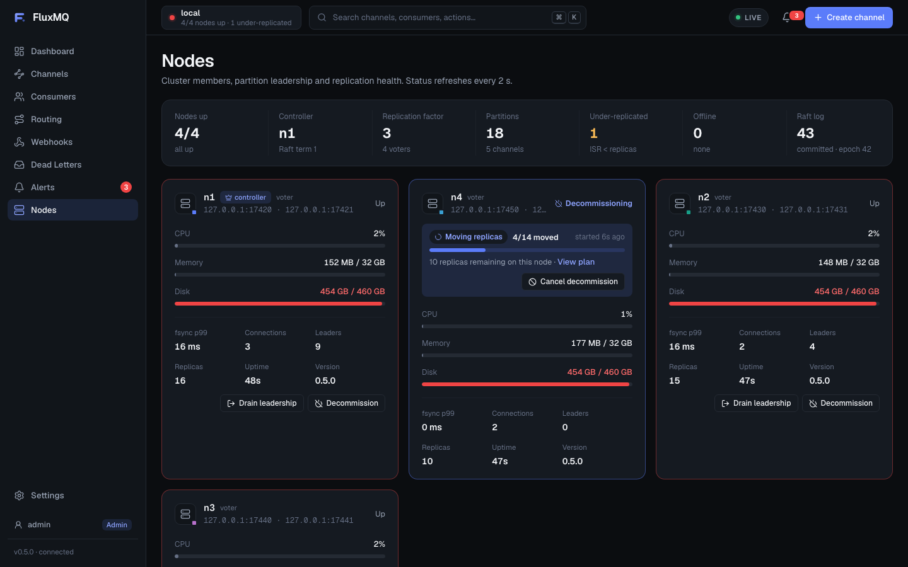 | 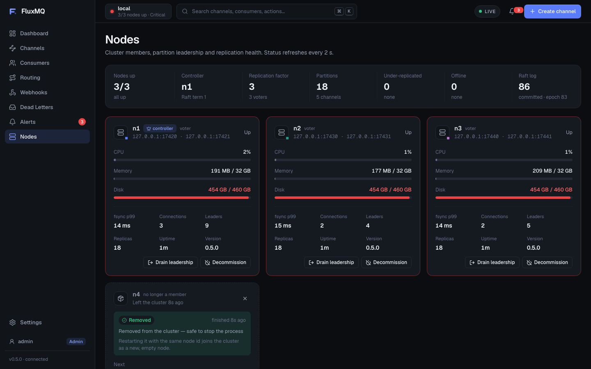 |
| 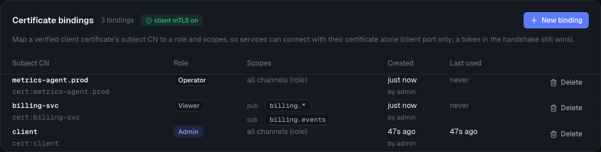 | 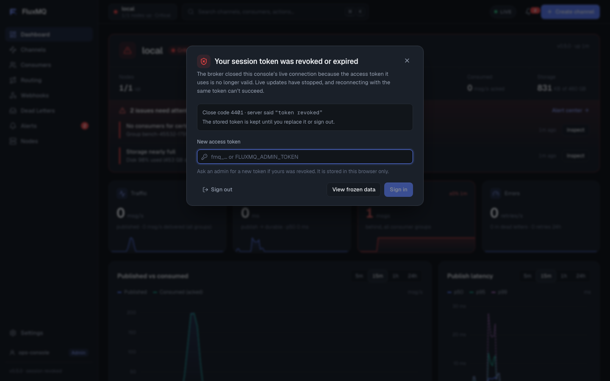 |

The v0.5 screenshots in [`ui/screenshots/real-v0.5/`](ui/screenshots/real-v0.5/) are taken from
real release builds (a 4-node cluster with data and light traffic; a single node with client
mTLS and `gen-dev` certificates). The red disk bars are real: the laptop's volume was nearly full.

### Docker quick start

```sh
deploy/build.sh                                            # -> fluxmq:dev (first build 6–10 min)
docker compose -f deploy/docker-compose.yml --profile single up -d
open http://localhost:37421                                # console; client port 37420
docker compose -f deploy/docker-compose.yml --profile cluster up -d   # 3 nodes, full TLS: https://localhost:37431
docker compose -f deploy/docker-compose.yml --profile '*' down -v     # stop everything, delete data
```

See [deploy/README.md](deploy/README.md) for profiles, ports and TLS, and
[bench/README.md](bench/README.md) to rerun the comparison (`bench/run.sh`).

## New in v0.4

- **TLS everywhere:** the client port (with optional mTLS; the certificate CN shows next to the
  connection), HTTPS + WSS for REST and the console, and mutual TLS between nodes (Raft,
  replication, internal HTTP) on top of the cluster secret. rustls with aws-lc-rs, TLS 1.2/1.3.
  Certificates reload without a restart (30 s file watch or `SIGHUP`; a bad file keeps the old
  certificate). `GET /api/tls`, the *Settings → Security* page, Prometheus metrics, and
  `tls_cert_expiring` / `tls_reload_failed` alerts. In a cluster these show on every node and
  the controller notifies once. SDK: `TlsOptions` and `tls://` addresses.
  `fluxmq tls gen-dev` writes development certificates.
- **Automatic rebalancing:** the controller restores the replication factor after a node has
  been down for `replace_after_secs`, and balances replicas and preferred leaders when a node
  joins or load drifts. Each move adds the new replica first and waits until it is in the ISR
  before removing the old one, so durability never drops. A move rolls back on timeout. The
  plan is persisted, so it resumes after a controller failover. Pause, resume, cancel and a
  dry-run preview are available in *Nodes → Rebalancing*, along with live catch-up lag and
  projected load. Catch-up can be throttled.
- **Safe replica moves:** new replicas bootstrap from the leader's log start and receive a
  snapshot of consumer offsets and the DLQ before joining the ISR. Removed replicas delete
  their copy.
- **Verified live** on a full-TLS cluster under load, with zero acknowledged messages lost
  in every scenario: a 4th node balanced in automatically (16 moves), a killed node repaired
  (21 moves), and the controller killed with kill -9 mid-plan (the plan resumed on the new
  controller). See [docs/CLUSTER.md](docs/CLUSTER.md) and
  [docs/BENCHMARKS.md](docs/BENCHMARKS.md).

| | |
|---|---|
| 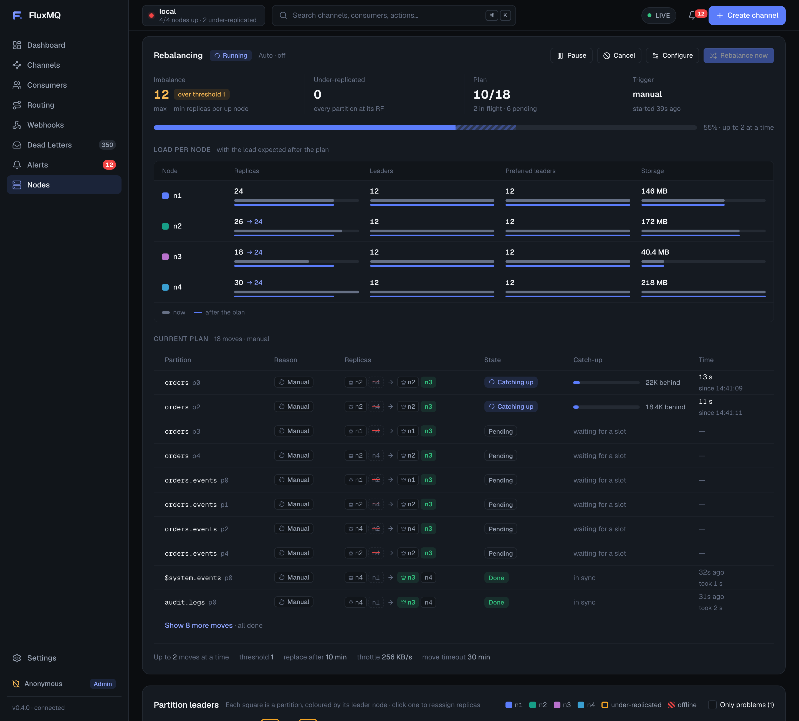 | 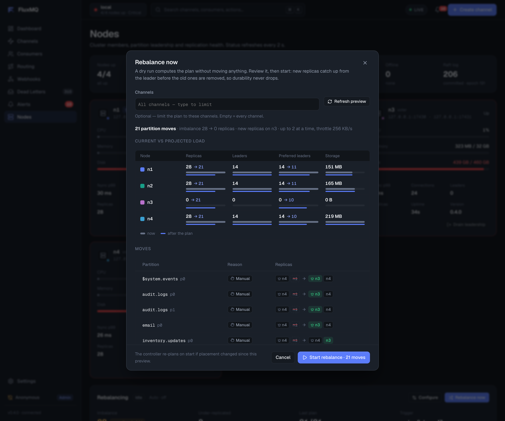 |
| 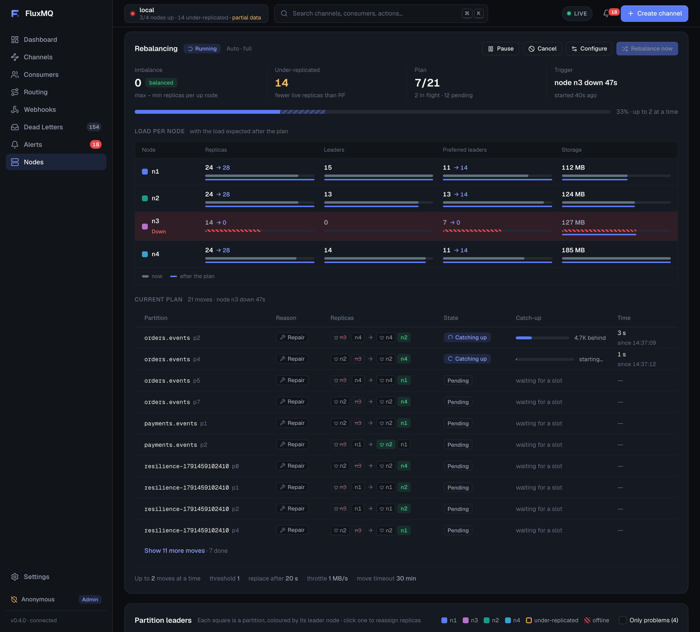 | 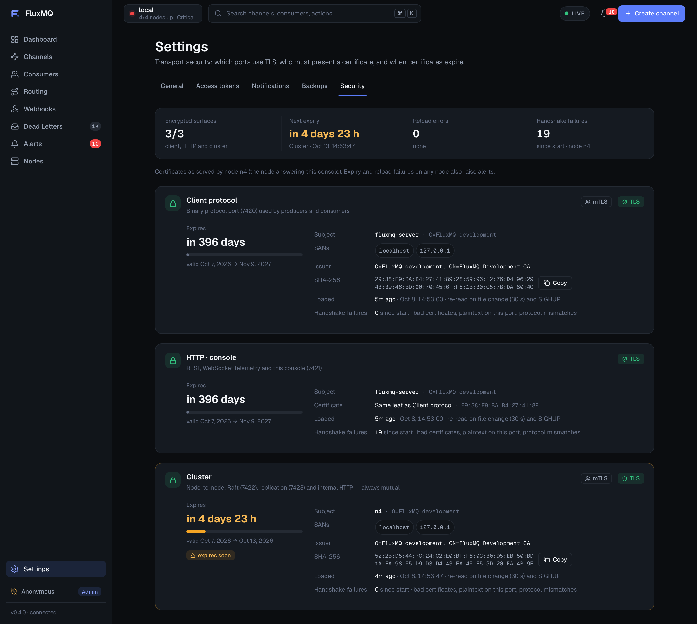 |

The v0.4 screenshots in [`ui/screenshots/real-v0.4/`](ui/screenshots/real-v0.4/) are taken
from a real 4-node cluster running full TLS (`gen-dev` certificates) with `fluxmq-demo` and
`resilience` traffic.

## New in v0.3

- **Notifications:** alerts and broker events to Telegram, Slack, Discord, email (SMTP),
  PagerDuty and signed generic webhooks. Rules with grouping windows ("7 issues need
  attention"), repeat intervals and recovery messages; dispatched once per cluster (by the
  controller); delivery history (any node shows the controller's). Test before saving, and
  test unsaved edits of a stored notifier.
- **Pull feed:** every alert transition and broker event is also appended to the system
  channel `$system.events`; `GET /api/events/feed` long-polls with a cursor
  (`after=<cursor>|latest`, `tail=N` to seed the newest items).
- **HTTP push webhooks:** the broker POSTs a channel's messages to your URL (consumer group
  `$webhook:<name>`): HMAC signatures, filters (same DSL as routes), batching, in-flight limit /
  strict order, `Retry-After`, retries and DLQ with short reasons (`HTTP 503`, `timeout`,
  `connection refused`, `blocked by policy`), SSRF guard re-checked at delivery time,
  cluster-wide stats; deliveries run on partition leaders.
- **Backups:** consistent, incremental backups to S3-compatible storage (AWS, MinIO, R2, B2)
  or a filesystem path, optional AES-256-GCM encryption, schedule + retention + GC, and
  `fluxmq restore` into an empty data directory (messages, groups, DLQ, tokens, routes,
  webhooks, notifiers). In a cluster the controller coordinates and every leader uploads its
  partitions; restore produces a single node.
- **Errors for humans and machines:** short error classes with a detail field
  (`error_detail`), and machine-readable `ApiError.error` codes such as
  `unsupported_in_cluster`.

| | |
|---|---|
| 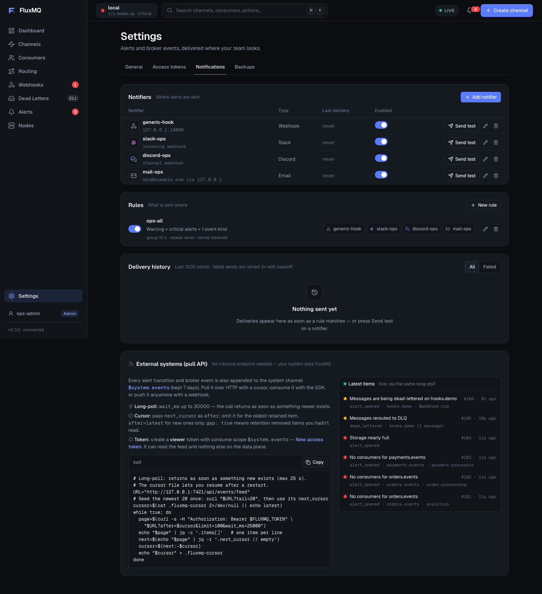 | 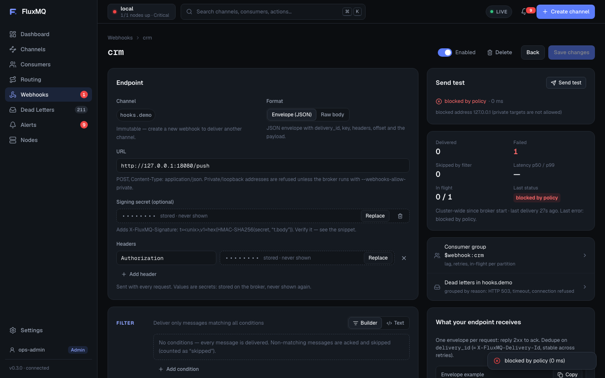 |
| 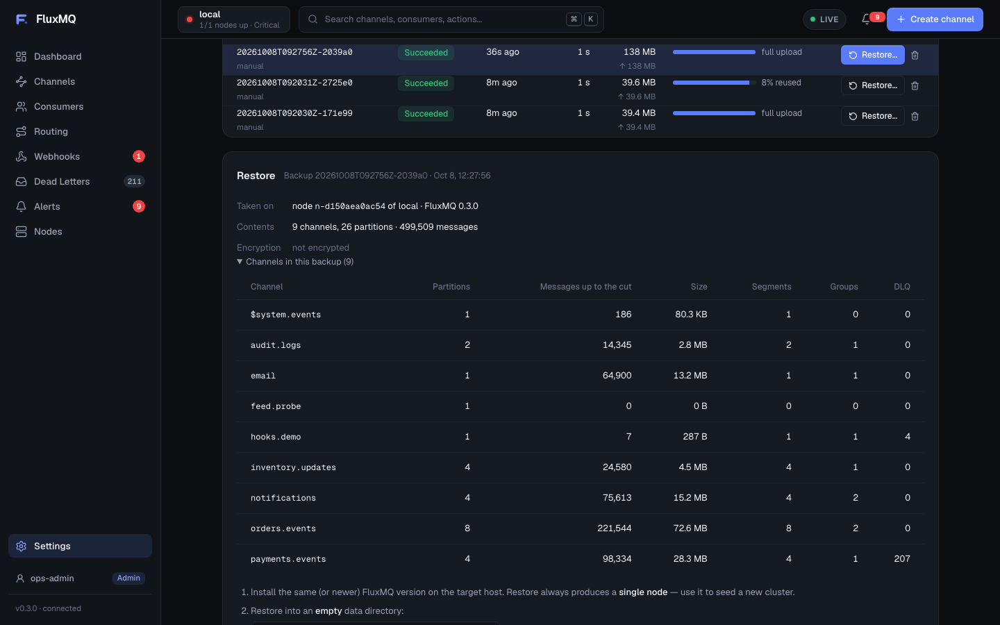 | 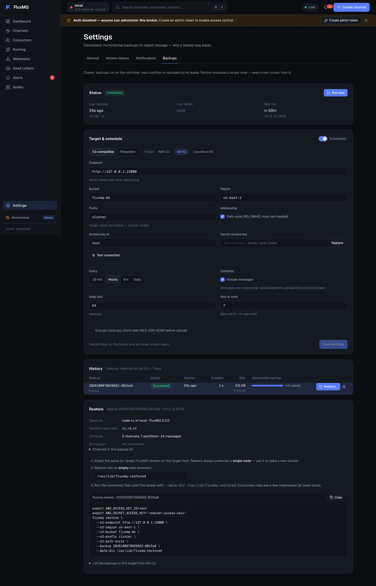 |

The v0.3 screenshots in [`ui/screenshots/real-v0.3/`](ui/screenshots/real-v0.3/) are taken from
a real broker (and a real 3-node cluster) with `fluxmq-demo` traffic, a local webhook receiver
and an S3 emulator.

## New in v0.2

- **RBAC:** named access tokens (`fmq_<id>_<secret>`, only a SHA-256 is stored) with roles
  viewer ⊂ operator ⊂ admin and per-token channel scopes for the client protocol; one central
  permission table for REST/WS; audit entries carry the token. The console creates the first
  (admin) token from open mode and greys out what your role can't do.
- **Content-based routing:** routes "messages of S matching C → channels T…", evaluated by a
  built-in router (consumer group `$router`, never on the publish path), loop protection,
  retries and DLQ, a WHEN/THEN editor with a live backtest, per-route counters.
- **Filter DSL** shared by routes and message search: `order_id = 8842 AND country = "MD"`
  (scan-based, errors point at the exact position).
- **Cluster:** Raft metadata (openraft), Kafka-style partition replication (ISR, high
  watermark, `acks=all`, epoch fencing), automatic failover, preferred-leader rebalancing,
  drain / reassign, graceful shutdown that hands leadership over first. Any node serves the
  API and console; reads fan out to partition leaders.
- **SDK:** reconnect with backoff, multiple seeds, cluster metadata, direct-to-leader
  publishes, per-node consumer subscriptions merged into one stream.
- **Observability:** cluster-wide telemetry merge, Nodes page with a partition matrix,
  cluster alerts, Prometheus `/metrics` on every node.
- Consumer-group deletion (`DELETE /api/channels/{name}/groups/{group}`, console *Delete group*).

| | |
|---|---|
| 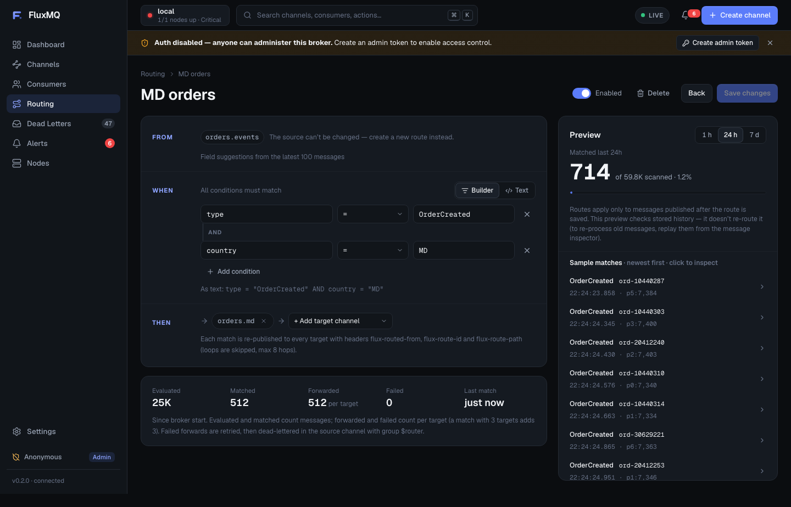 | 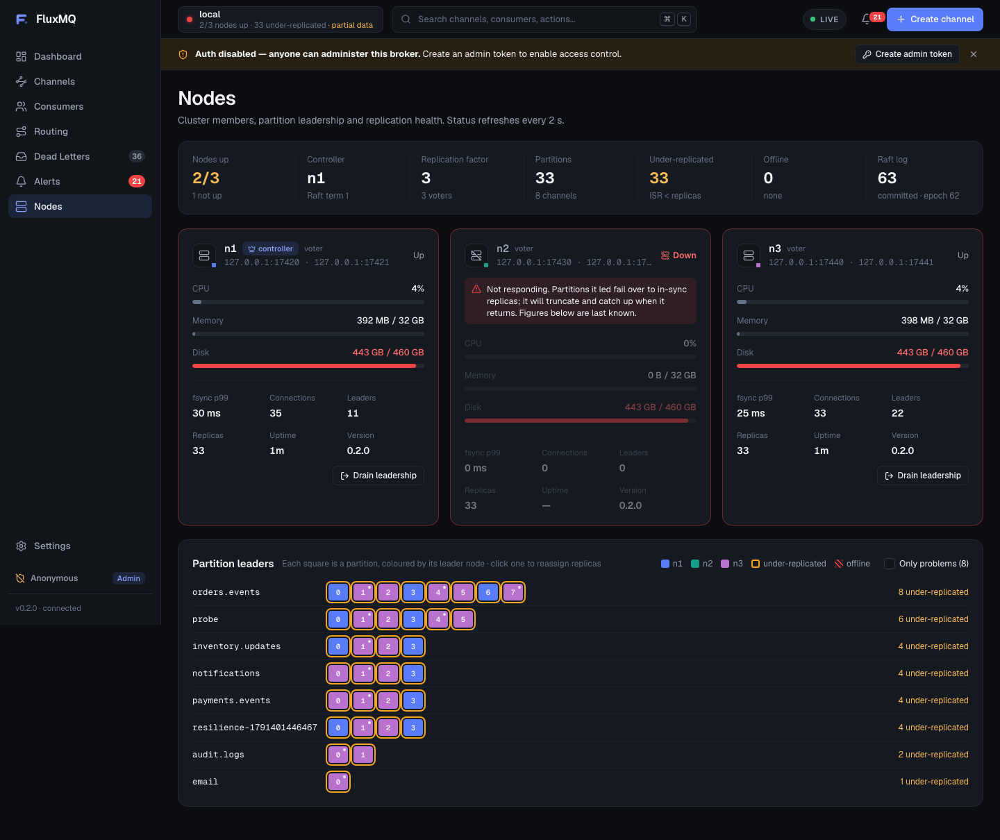 |
| 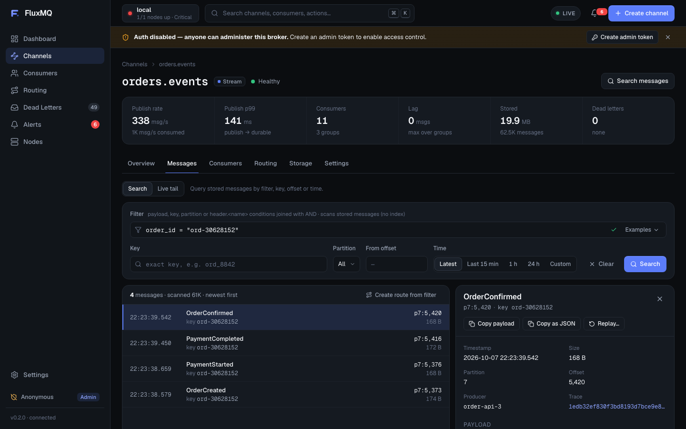 | 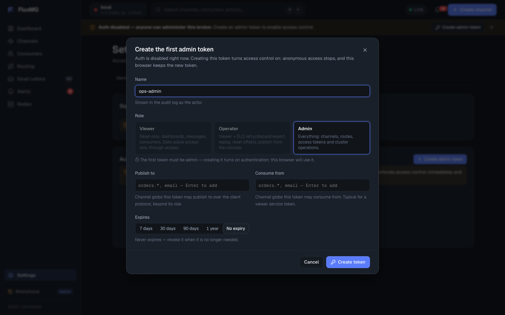 |

All screenshots in [`ui/screenshots/real-v0.2/`](ui/screenshots/real-v0.2/) are taken from a
real broker / real 3-node cluster running `fluxmq-demo`.

## What works (since v0.1)

- **Channels** in three modes: `stream` (partitioned, replayable log; partitions are spread
  across a group's instances), `queue` (competing consumers), `keyed` (strict order per key,
  other keys keep flowing). Fan-out to any number of consumer groups.
- **Durable storage:** segmented append-only log with CRC'd records, group commit (2 ms,
  default) or OS-buffered writes, and retention by age or size. Channel configs, group
  offsets (1 s checkpoints) and the DLQ survive restarts.
- **Delivery:** per-message ack/nack, prefetch, ack timeouts, retries with a backoff
  schedule, dead-lettering with the failure reason, DLQ retry/discard/export, replay of stored
  messages, consumer-group offset reset (earliest / latest / timestamp).
- **Web console** (`ui/`, served by the broker): dashboard with an alert center, channels,
  per-group and per-instance consumer health (CPU, processing p99, last error from the SDK),
  message search by key, offset or time, live tail, message inspector with the per-group
  retry timeline, an error inbox grouped by reason, nodes, a create-channel wizard and a ⌘K
  command palette.
- **Built-in telemetry:** rates and HDR latency percentiles, health rules and alerts (lag
  growth, stalled consumers, slow instance, DLQ growth, high publish latency, disk), events
  feed, and history (1 s → 1 m → 30 m rollups, up to 7 days).
- **Rust SDK** (`fluxmq-client`) over a compact binary TCP protocol, plus a REST API for
  everything the console does.
- **Ops basics:** bootstrap admin token plus access tokens (v0.2), an audit log of every
  mutating call, and graceful shutdown.
- **Tooling:** `fluxmq-demo` (an e-commerce story that exercises every screen) and
  `fluxmq-bench` (closed- and open-loop throughput/latency); see
  [docs/BENCHMARKS.md](docs/BENCHMARKS.md).

## Install

```sh
# Docker (amd64 / arm64)
docker run -d --name fluxmq -p 7420:7420 -p 7421:7421 -v fluxmq:/var/lib/fluxmq ghcr.io/futurist-network/fluxmq

# Linux server with systemd (x86_64 / aarch64, glibc 2.36+): binary, /etc/fluxmq/fluxmq.toml,
# a generated admin token and the `fluxmq` service; re-run to upgrade
curl -fsSL https://raw.githubusercontent.com/futurist-network/fluxmq/master/deploy/install.sh | sudo sh
```

Then open <http://localhost:7421>. The console is built into the binary; settings live in
[`fluxmq.toml`](deploy/fluxmq.toml) (see [Running](#running)).

## 60-second quickstart (from source)

Needs Rust ≥ 1.88, Node ≥ 20.19 and pnpm 9.

```sh
cd ui && pnpm install && pnpm build && cd ..        # web console → ui/dist (built into the binary)
cargo build --release -p fluxmq-server -p fluxmq-client
./target/release/fluxmq --data-dir ./data &          # broker: TCP 7420, HTTP 7421
./target/release/fluxmq-demo &                       # realistic demo traffic
open http://localhost:7421                           # (xdg-open on Linux)
```

Within a minute the demo produces real problems for the console to show: a slow email
worker, an inventory consumer that stalls every few minutes, and payments that get
dead-lettered with `Invalid schema`. For a development loop with hot reload, run
`scripts/dev.sh`, which starts a debug broker, the demo and the Vite dev server on
<http://localhost:5173>.

**3-node cluster on one machine:** see [docs/CLUSTER.md](docs/CLUSTER.md) (English) or section 19 of
[docs/GUIDE.ru.md](docs/GUIDE.ru.md) (Russian user guide) — three `fluxmq --node-id nN --peers …`
commands, then `fluxmq-demo --seeds 127.0.0.1:17420,127.0.0.1:17430,127.0.0.1:17440`.

## Architecture

```text
 producers / consumers ──TCP :7420──► fluxmq-server ──► fluxmq-core (storage, groups, retry, DLQ)
                                          │                   │ pull: cumulative stats
 browser ◄── HTTP/WS :7421 ── fluxmq-api ◄┘   fluxmq-telemetry ◄┘ (rates, percentiles, alerts, history)
```

The data plane never waits for the observability plane. Core exposes pull-based counters and
histograms, and push paths (events, live tail) use bounded `try_send` channels. The UI
receives a snapshot and then JSON merge-patch deltas per subscribed topic.

| Crate | Role |
|---|---|
| `fluxmq-proto` | Shared contract: model, wire protocol, REST bodies, telemetry documents |
| `fluxmq-core` | Broker engine: segmented log, group commit, consumer groups, retry/DLQ |
| `fluxmq-telemetry` | Collector, health rules, alerts, history rollups, WS sessions |
| `fluxmq-api` | axum REST + WebSocket + static UI, permission table, cluster fan-out |
| `fluxmq-auth` | Access tokens and roles (RBAC) |
| `fluxmq-router` | Content-based routing and the filter DSL |
| `fluxmq-meta` | Revisioned metadata store (local `meta.json` or Raft) |
| `fluxmq-cluster` | Raft (openraft), controller, failover, rebalancing planner + executor, internal RPC |
| `fluxmq-replication` | Partition replication (followers fetch from leaders, ISR, HW) |
| `fluxmq-notify` | Notifications (rules, grouping, senders) and the `$system.events` feed |
| `fluxmq-webhooks` | HTTP push subscriptions (`$webhook:<name>` groups, signatures, SSRF guard) |
| `fluxmq-backup` | Incremental backups to S3/filesystem, encryption, retention, restore |
| `fluxmq-tls` | rustls TLS for every surface: reloadable certificates, mTLS, cluster TLS, `gen-dev` |
| `fluxmq-server` | The `fluxmq` binary: config, TCP client protocol, shutdown, `backup`/`restore` CLI |
| `fluxmq-client` | Rust SDK, `fluxmq-bench`, `fluxmq-demo` |

More: [docs/ARCHITECTURE.md](docs/ARCHITECTURE.md) covers routes, semantics and the telemetry
contract, [docs/CLUSTER.md](docs/CLUSTER.md) running a cluster, [docs/GUIDE.ru.md](docs/GUIDE.ru.md)
is the full user guide (Russian), [docs/BENCHMARKS.md](docs/BENCHMARKS.md) has the benchmarks, and
[ui/README.md](ui/README.md) explains the console and its mock server.

## SDK

```rust
use fluxmq_client::{Client, ClientOptions, StartFrom, SubscribeOptions, message};
use fluxmq_proto::{ChannelConfig, ChannelMode};

let client = Client::connect(ClientOptions::new("127.0.0.1:7420", "order-api")).await?;
client.ensure_channel(ChannelConfig::new("orders", ChannelMode::Stream)).await?;

// Produce
let producer = client.producer("orders");
let id = producer
    .send(message(r#"{"order_id":"ord-1","amount":42}"#)
        .key("ord-1")
        .event_type("OrderCreated")
        .content_type("application/json"))
    .await?;

// Consume (group "billing"). `delivery.nack(reason, true)` retries with backoff, then dead-letters.
let mut consumer = client
    .subscribe("orders", "billing", SubscribeOptions::default().prefetch(32).start(StartFrom::Earliest))
    .await?;
while let Some(delivery) = consumer.next().await {
    let delivery = delivery?;
    println!("{:?}: {}", delivery.key(), String::from_utf8_lossy(delivery.payload()));
    delivery.ack().await?;
}
```

Runnable versions: `cargo run -p fluxmq-client --example producer` and `--example consumer`.

### Reconnect and clusters

The client reconnects by itself (exponential backoff + jitter), resubscribes consumers and
retries publishes. Given several seeds, it fetches cluster metadata, partitions messages
client-side with the broker's own function (`crc32(key) % partitions`, round-robin without a
key), publishes directly to partition leaders and consumes from every leader node through one
merged stream. A broker without cluster support answers `Metadata` with `BadRequest`, and the
client then routes everything through one connection (v0.1 behaviour).

```rust
use std::time::Duration;
use fluxmq_client::{Client, ClientOptions, ReconnectPolicy};

let client = Client::connect(
    ClientOptions::with_seeds(["n1:7420", "n2:7420", "n3:7420"], "order-api")
        .reconnect(ReconnectPolicy::default().backoff(Duration::from_millis(100), Duration::from_secs(5)))
        .publish_timeout(Duration::from_secs(30)),
).await?;
let mut state = client.state(); // watch: Connecting / Connected / Reconnecting / Closed
```

Publishes are retried on connection loss, timeouts, `NotLeader` and `Overloaded` until
`publish_timeout`; `BadRequest`/`Forbidden` are never retried. **A retried publish can be stored
twice** (delivery is at-least-once), so keep consumers idempotent. `BatchingOptions { ordered:
true, .. }` keeps per-key order across retries. `cargo run -p fluxmq-client --example resilience`
checks for lost acknowledged publishes while you `kill -9` and restart the broker.

## Project layout

```text
crates/       Rust workspace (see the table above)
ui/           web console (Vite + React + TypeScript), mock broker in ui/mock
docs/         ARCHITECTURE.md, CLUSTER.md, GUIDE.ru.md, ROADMAP.md, BENCHMARKS.md
scripts/      dev.sh: broker + demo + UI dev server
```

## Status and roadmap

v0.1 covered roadmap stages 0–6 on a single node. v0.2 adds stage 7 (RBAC), most of stage 8
(routing, filter search — scan-based, no payload index yet) and the core of stage 9 (cluster
with replication, Nodes page, Prometheus). v0.3 adds notifications + the events feed, HTTP push
webhooks and backups/restore (single node and cluster). v0.4 (stage 11) adds TLS on every
surface and automatic rebalancing with safe replica moves. v0.5 (stage 12) adds batched
delivery, live-session revocation and certificate bindings, node decommission / forget,
persistent notification history, Docker packaging and the comparative benchmark. Not done:
payload field indexing, OTel export, rack awareness, a byte-aware planner, Raft leadership
transfer, decommissioning several nodes at once, CA reload without restart / CRL / OCSP,
point-in-time restore into a cluster, OIDC/SSO. Details in
[docs/ROADMAP.md](docs/ROADMAP.md), limitations in section 17 of
[docs/GUIDE.ru.md](docs/GUIDE.ru.md) and in [docs/BENCHMARKS.md](docs/BENCHMARKS.md#caveats)
(including the replicated numbers).

## License

Apache-2.0 (see [LICENSE](LICENSE) and [NOTICE](NOTICE)). Copyright 2026 Futurist Network.

## Running

```sh
cargo run --release -p fluxmq-server -- --data-dir ./data
```

The broker listens on `7420` (client protocol, TCP) and `7421` (REST API, WebSocket telemetry
and the web UI at <http://localhost:7421/>). The UI is embedded from `ui/dist` at build time:
build it first with `cd ui && pnpm install && pnpm build`, otherwise `/` shows a hint page.

Every flag can also be set by its `FLUXMQ_*` environment variable or in a TOML file passed with
`--config` (`FLUXMQ_CONFIG`), keyed by flag name: see [deploy/fluxmq.toml](deploy/fluxmq.toml).
A flag beats the environment, which beats the file. Unknown keys are an error.

| Flag | Env | Default |
|---|---|---|
| `--data-dir` | `FLUXMQ_DATA_DIR` | `./data` |
| `--client-addr` | `FLUXMQ_CLIENT_ADDR` | `0.0.0.0:7420` |
| `--http-addr` | `FLUXMQ_HTTP_ADDR` | `0.0.0.0:7421` |
| `--cluster-name` | `FLUXMQ_CLUSTER_NAME` | `local` |
| `--config` | `FLUXMQ_CONFIG` | none |
| `--ui` | `FLUXMQ_UI` | `on` (`off`: API only) |
| `--ui-dir` | `FLUXMQ_UI_DIR` | none (the built-in console) |
| `--admin-token` | `FLUXMQ_ADMIN_TOKEN` | none (dev mode: everything open) |
| `--admin-token-file` | `FLUXMQ_ADMIN_TOKEN_FILE` | none (reads the token from a file) |
| `--fsync` | `FLUXMQ_FSYNC` | `group-commit` (or `os`) |
| `--log` | `FLUXMQ_LOG` / `RUST_LOG` | `info` |

With `--admin-token` or once any access token exists, REST and `/ws` need
`Authorization: Bearer <token>` (`/ws` also accepts `?token=`) and clients must send it in
`Hello`. `/api/health` stays open. Cluster flags (`--node-id`, `--peers`, `--raft-addr`,
`--replication-addr`, `--advertise-host`, `--replication-factor`, `--min-isr`,
`--cluster-secret` / `--cluster-secret-file`) are described in [docs/CLUSTER.md](docs/CLUSTER.md).

Development: `scripts/dev.sh` runs a debug broker on `./data-dev`, the demo traffic generator
(`fluxmq-demo`) and the UI dev server together; Ctrl-C stops everything.
SIGINT/SIGTERM shut the broker down gracefully (in a cluster it first hands its partition
leaderships over and leaves the ISRs; clients get `Goodbye`, data is flushed).
